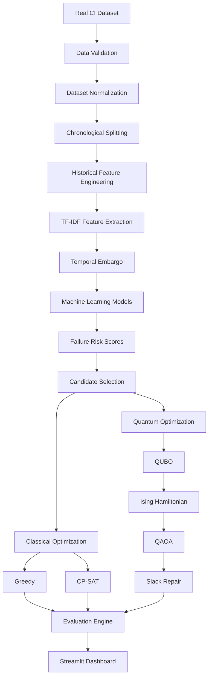

# QuantCI

### Machine Learning and Quantum-Classical Optimization for Intelligent Software Testing


## Overview

QuantCI is a research-oriented software test selection platform that combines machine learning, mathematical optimization and quantum-classical algorithms to prioritize software tests under constrained execution budgets.

The system analyzes historical test executions, commit messages, source-code changes and test behavior to estimate failure risk and optimize test selection.

QuantCI uses real-world continuous integration data from the Apache ActiveMQ project through the Long-Running Test Suites dataset.

## Key Features

- Real-world CI dataset processing
- Chronological dataset splitting
- Temporal embargo validation
- Historical feature engineering
- TF-IDF text representation
- Logistic Regression and Random Forest
- Failure-risk prediction
- Budget-constrained test selection
- Greedy optimization
- OR-Tools CP-SAT optimization
- QUBO formulation
- Ising Hamiltonian conversion
- Quantum Approximate Optimization Algorithm
- Quantum candidate pruning
- Classical slack repair
- Random sampling control experiments
- Interactive Streamlit dashboard
- Automated regression testing

## System Architecture



## Dataset

QuantCI uses the Long-Running Test Suites dataset.

| Attribute | Value |
|---|---:|
| Project | Apache ActiveMQ |
| Test executions | 159,402 |
| Passed executions | 159,045 |
| Failed executions | 357 |
| Unique test classes | 1,112 |
| Test-suite runs | 207 |
| Unique commits | 177 |
| Failure rate | 0.224% |
| ML features | 726 |

Dataset repository:

https://github.com/lrtsuser/LRTS

Original Jenkins report archive:

https://doi.org/10.5281/zenodo.15603448

The raw dataset is not distributed with this repository.

## Machine Learning Pipeline

QuantCI uses historical test behavior and textual representations of software changes.

### Historical Features

- Historical execution count
- Historical failure count
- Historical failure rate
- Smoothed failure rate
- Previous failure outcome
- Historical execution duration
- Recent failure rates
- Consecutive failures
- Time since previous execution
- Time since previous failure

### Text Features

- Commit message TF-IDF
- Changed file TF-IDF
- Test class name TF-IDF
- Test-to-commit similarity
- Test-to-file similarity

### Models

- Majority baseline
- Random ranking baseline
- Global failure-rate baseline
- Historical failure-rate baseline
- Smoothed historical baseline
- Logistic Regression
- Random Forest

Random Forest was selected using validation average precision.

## Machine Learning Results

The chronological test partition contains 27,786 test executions and 15 observed failures.

| Metric | Random Forest |
|---|---:|
| ROC AUC | 0.9731 |
| Average precision | 0.02595 |
| Top 10% failure recall | 100% |
| Failures detected at top 10% | 15/15 |
| Selected executions at top 10% | 2,796 |
| Fixed-threshold recall | 26.67% |
| Fixed-threshold precision | 4.88% |

The historical smoothed baseline achieved higher test average precision than the selected Random Forest model.

Model outputs are uncalibrated risk scores rather than calibrated failure probabilities.

## Optimization Objective

QuantCI maximizes predicted test failure risk while penalizing redundancy and satisfying an estimated execution budget.

```math
\max_x \left(
\sum_i r_i x_i -
\lambda \sum_{i<j}s_{ij}x_ix_j
\right)
```

Subject to:

```math
\sum_i t_i x_i \leq B
```

Where:

| Symbol | Meaning |
|---|---|
| x | Binary test selection |
| r | Predicted failure risk |
| t | Estimated test duration |
| s | Test-name similarity |
| B | Execution budget |
| lambda | Redundancy penalty |

## Quantum Optimization Pipeline


The quantum component uses Qiskit Aer for local simulation.

| Parameter | Value |
|---|---:|
| Original binary variables | 15 |
| Reduced binary variables | 14 |
| Original state space | 32,768 |
| Reduced state space | 16,384 |
| State-space reduction | 50% |
| Candidate tests | 9 |
| Execution budget | 120 seconds |

## Optimization Benchmark

The following results were obtained on one shared validation instance.

| Algorithm | Mean Approximation Ratio | Mean Runtime |
|---|---:|---:|
| Greedy | 100% | 0.523 ms |
| OR-Tools CP-SAT | 100% | 7.982 ms |
| Exact Enumeration | 100% | 0.282 ms |
| Random Sampling | 89.56% | 404.618 ms |
| Random + Repair | 100% | 914.329 ms |
| QAOA | 93.90% | 3,353.287 ms |
| QAOA + Repair | 100% | 3,963.318 ms |

Quantum computational advantage was not demonstrated.

Classical exact enumeration was the fastest evaluated approach on this small problem.

## Technology Stack

| Layer | Technology |
|---|---|
| Programming Language | Python |
| Data Processing | Pandas, NumPy |
| Machine Learning | Scikit-learn |
| Sparse Matrices | SciPy |
| Classical Optimization | Google OR-Tools |
| Quantum Computing | Qiskit |
| Quantum Simulation | Qiskit Aer |
| Visualization | Matplotlib, Plotly |
| Frontend | Streamlit |
| Testing | Pytest |

## Project Structure

```text
QuantCI/
├── .streamlit/
├── data/
│   ├── raw/
│   └── processed/
├── docs/
├── models/
├── results/
│   ├── benchmark/
│   ├── heldout/
│   ├── optimization/
│   ├── quantum/
│   ├── quantum_experiments/
│   └── plots/
├── src/
│   ├── data/
│   ├── features/
│   ├── ml/
│   ├── optimization/
│   ├── quantum/
│   ├── evaluation/
│   ├── demo/
│   └── config.py
├── tests/
├── requirements.txt
├── verify_env.py
└── README.md
```

## Installation

Clone the repository.

```bash
git clone https://github.com/karthikkb0580-cmd/Quant-CI.git
cd Quant-CI
```

Create a virtual environment.

```bash
python -m venv .venv
```

Activate the environment on Windows PowerShell.

```powershell
.\.venv\Scripts\Activate.ps1
```

Install dependencies.

```bash
python -m pip install -r requirements.txt
```

Verify the environment.

```bash
python verify_env.py
```

## Running the Dashboard

After generating the required dataset, prediction and benchmark artifacts:

```bash
python -m streamlit run src/demo/app.py
```

Open the local Streamlit address displayed in the terminal.

## Testing

```bash
python -m pytest tests -v
```

## Research Limitations

- The dataset is highly imbalanced.
- The test partition contains only 15 failures.
- Candidate test rosters are retrospectively observed.
- Historical durations are estimates of future execution costs.
- Execution costs represent cumulative serial test duration.
- Test-name similarity is a redundancy proxy, not code coverage.
- Model outputs are not calibrated probabilities.
- Quantum experiments use a small validation instance.
- Simulator performance does not represent quantum hardware performance.
- Quantum computational advantage has not been established.

## Future Work

- Integration with live CI/CD pipelines
- Evaluation across additional software repositories
- Probability calibration
- Code coverage-based redundancy estimation
- Runtime uncertainty modeling
- Parallel execution scheduling
- Multi-objective optimization
- Quantum hardware experimentation

## Author

Karthik K B

B.Tech Artificial Intelligence and Machine Learning

## Acknowledgements

- Long-Running Test Suites dataset contributors
- Apache ActiveMQ community
- Qiskit open-source community
- Scikit-learn contributors
- Google OR-Tools contributors
- Streamlit contributors