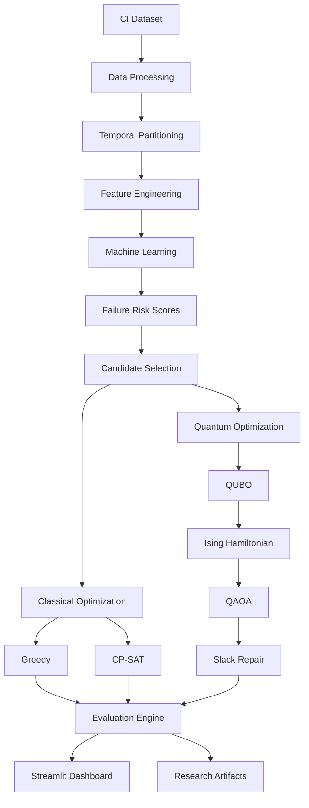
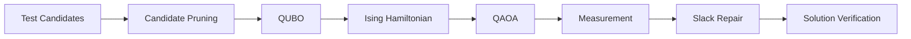

# QuantCI

Machine learning and quantum-classical optimization for budget-constrained software test selection.

[](https://github.com/karthikkb0580-cmd/Quant-CI/actions/workflows/ci.yml)


## Overview

QuantCI is an experimental software test selection system that combines machine learning, mathematical optimization, and quantum computing to prioritize test execution under constrained computational budgets.

The system processes historical continuous integration data, extracts numerical and textual features, estimates test failure risk, and selects test subsets using classical and quantum-classical optimization algorithms.

The project evaluates whether increasingly complex optimization techniques provide measurable improvements over simpler baselines using real-world Apache ActiveMQ continuous integration data.

## Features

- Historical CI data processing and validation
- Chronological dataset partitioning with temporal embargo
- Historical and TF-IDF feature engineering
- Machine learning-based failure-risk ranking
- Budget-constrained test selection
- Greedy and CP-SAT optimization
- QUBO and Ising Hamiltonian formulation
- QAOA simulation using Qiskit Aer
- Constraint-based candidate pruning
- Classical slack repair
- Comparative algorithm benchmarking
- Interactive research dashboard
- Automated regression testing

## Architecture



## Technology Stack

| Component | Technology |
|---|---|
| Language | Python |
| Data Processing | NumPy, Pandas |
| Machine Learning | Scikit-learn |
| Numerical Computing | SciPy |
| Classical Optimization | Google OR-Tools |
| Quantum Computing | Qiskit |
| Quantum Simulation | Qiskit Aer |
| Visualization | Matplotlib, Plotly |
| Application | Streamlit |
| Testing | Pytest |
| Version Control | Git |

## Quick Start

The dashboard operates on precomputed prediction files and evaluation artifacts stored in `results/`.

When these artifacts are included in the repository, no raw dataset download, model training, or quantum simulation is required to launch the application.

### Clone the repository

```bash
git clone https://github.com/karthikkb0580-cmd/Quant-CI.git
cd Quant-CI
```

### Create a virtual environment

```bash
python -m venv .venv
```

Windows:

```powershell
.\.venv\Scripts\Activate.ps1
```

Linux/macOS:

```bash
source .venv/bin/activate
```

### Install dependencies

```bash
python -m pip install -r requirements.txt
```

### Verify the environment

```bash
python verify_env.py
```

### Run the application

```bash
python -m streamlit run src/demo/app.py
```

The application is available at:

```text
http://localhost:8501
```

The verified development environment is Python 3.14.10 on Windows. Other environments and fresh-clone execution have not yet been independently validated.

## Dataset

QuantCI uses the Long-Running Test Suites (LRTS) dataset, specifically historical CI execution records from Apache ActiveMQ.

| Attribute | Value |
|---|---:|
| Test executions | 159,402 |
| Successful executions | 159,045 |
| Failed executions | 357 |
| Unique test classes | 1,112 |
| Test-suite runs | 207 |
| Unique commits | 177 |
| Failure rate | 0.224% |
| Engineered features | 726 |

### Dataset Partitioning

| Partition | Executions | Failures | Runs |
|---|---:|---:|---:|
| Training | 107,426 | 305 | 144 |
| Validation | 19,738 | 37 | 26 |
| Test | 27,786 | 15 | 32 |

A temporal embargo excludes 4,452 validation executions to reduce cross-partition temporal contamination.

### Sources

- [LRTS Dataset Repository](https://github.com/lrtsuser/LRTS)
- [Original Jenkins Reports](https://doi.org/10.5281/zenodo.15603448)

Raw datasets and trained model binaries are excluded from version control.

## Machine Learning

The machine learning pipeline combines historical test behavior with textual representations of software changes.

### Feature Engineering

- Historical execution statistics
- Historical failure frequency
- Smoothed failure rates
- Recent failure behavior
- Historical execution duration
- Commit message TF-IDF
- Changed file TF-IDF
- Test class TF-IDF
- Test-to-change textual similarity

### Evaluated Models

- Majority baseline
- Random ranking
- Global failure-rate baseline
- Historical failure-rate baseline
- Smoothed historical baseline
- Logistic Regression
- Random Forest

Random Forest was selected using validation average precision.

### Evaluation Results

| Metric | Random Forest | Smoothed Historical Baseline |
|---|---:|---:|
| Validation Average Precision | 0.06940 | 0.03770 |
| Test Average Precision | 0.02595 | 0.02867 |
| Test ROC AUC | 0.97310 | 0.98410 |
| Top 10% Failure Recall | 100% | 93.33% |
| Failures Detected at Top 10% | 15/15 | 14/15 |

The selected Random Forest model remains competitive with simple historical baselines but does not consistently outperform them.

Extreme class imbalance, limited positive examples, and the small number of test failures are plausible explanations for the observed results.

The model produces uncalibrated failure-risk scores rather than calibrated probabilities.

## Optimization

Test selection is formulated as a binary constrained optimization problem that maximizes predicted failure risk while penalizing redundancy.

### Objective Function

$$
\max_x \left(
\sum_i r_i x_i -
\lambda \sum_{i<j}s_{ij}x_ix_j
\right)
$$

Subject to:

$$
\sum_i t_i x_i \leq B
$$

$$
x_i \in \{0,1\}
$$

| Symbol | Description |
|---|---|
| $x_i$ | Binary test selection |
| $r_i$ | Predicted failure-risk score |
| $t_i$ | Estimated execution duration |
| $s_{ij}$ | Pairwise test similarity |
| $\lambda$ | Redundancy penalty |
| $B$ | Estimated execution budget |

Test-name similarity is used as a proxy for redundancy rather than direct code coverage.

### Classical Optimization

The classical optimization layer implements:

- Random selection
- Shortest-first selection
- Historical-risk selection
- ML-risk selection
- Greedy marginal-gain optimization
- OR-Tools CP-SAT

Both Greedy and CP-SAT produced feasible solutions across all 104 validation problems under estimated execution constraints.

## Held-Out Evaluation

The held-out evaluation compares six selection strategies across four execution budgets and 32 test-suite runs, producing 768 run-level evaluations.

All strategies operate on a shared ML-ranked shortlist of up to 200 candidates per run.

### Results at a 120-Second Estimated Budget

| Strategy | Failure Recall | Runtime Reduction | Budget Overrun | Missed Failure Runs |
|---|---:|---:|---:|---:|
| Random | 46.67% | 99.23% | 62.50% | 63.64% |
| Shortest First | 66.67% | 99.21% | 78.13% | 45.45% |
| Historical Risk | 60.00% | 99.26% | 59.38% | 54.55% |
| ML Risk | 66.67% | 99.19% | 65.63% | 45.45% |
| Greedy | 66.67% | 99.22% | 68.75% | 45.45% |
| CP-SAT | 66.67% | 99.22% | 75.00% | 45.45% |

### Highest Observed Failure Recall

ML-risk selection at a 300-second estimated execution budget achieved the highest observed failure recall.

| Metric | Result |
|---|---:|
| Detected failures | 12/15 |
| Failure recall | 80.00% |
| Cumulative runtime reduction | 98.24% |
| Actual budget overrun rate | 56.25% |
| Missed failure-run rate | 27.27% |
| Candidate recall | 100% |
| Mean selection time | 1.784 ms |

This configuration was identified retrospectively and is not an independently validated deployment recommendation.

Runtime reduction measures cumulative serial test duration rather than end-to-end CI wall-clock acceleration.

The observed budget overruns and missed failure runs demonstrate the limitations of historical duration estimation and aggressive test selection.

## Quantum Optimization

The quantum optimization pipeline converts the constrained test selection problem into a Quadratic Unconstrained Binary Optimization formulation and subsequently into an Ising Hamiltonian.



### Experimental Configuration

| Parameter | Configuration |
|---|---|
| Framework | Qiskit |
| Simulator | Qiskit Aer |
| Execution | Local CPU |
| Optimizer | COBYLA |
| QAOA Repetitions | 1, 2 |
| Measurement Shots | 1,024, 4,096 |
| Maximum Iterations | 50, 100 |
| Random Seeds | 42, 123, 2026 |

### Candidate Pruning

| Metric | Original | Pruned |
|---|---:|---:|
| Candidate Tests | 10 | 9 |
| Slack Variables | 5 | 5 |
| Binary Variables | 15 | 14 |
| State Space | 32,768 | 16,384 |

Constraint-based pruning reduced the encoded state space by 50% while preserving the exact optimal objective value for the evaluated instance.

## Benchmark Results

Seven optimization variants were evaluated across 84 benchmark records using a shared validation instance.

| Algorithm | Mean Approximation Ratio | Mean Runtime |
|---|---:|---:|
| Greedy | 100.00% | 0.523 ms |
| CP-SAT | 100.00% | 7.982 ms |
| Exact Enumeration | 100.00% | 0.282 ms |
| Random Sampling | 89.56% | 404.618 ms |
| Random Sampling + Repair | 100.00% | 914.329 ms |
| QAOA | 93.90% | 3,353.287 ms |
| QAOA + Repair | 100.00% | 3,963.318 ms |

### Findings

At the evaluated problem size, QAOA with classical repair provides no demonstrated solution-quality advantage over random sampling with the same repair procedure.

Both repaired approaches achieved a mean approximation ratio of 100%, while QAOA with repair required approximately 4.33 times the runtime.

Classical exact enumeration was the fastest evaluated approach.

The experiment validates the implementation of a quantum-classical optimization pipeline but does not demonstrate quantum computational advantage.

## Dashboard

The Streamlit application provides six research modules.

| Module | Functionality |
|---|---|
| Overview | Project metrics and architecture |
| Dataset Intelligence | Dataset exploration and visualization |
| ML Intelligence | Model evaluation and comparison |
| Test Optimizer | Interactive classical optimization |
| Quantum Laboratory | Quantum-classical benchmark analysis |
| Research Analytics | Held-out evaluation and trade-off analysis |

The dashboard uses saved research artifacts to provide interactive visualizations, configurable optimization parameters, and CSV exports.

## Project Structure

```text
QuantCI/
├── .github/
│   └── workflows/
├── .streamlit/
│   └── config.toml
├── data/
│   ├── raw/
│   └── processed/
├── docs/
├── models/
├── results/
│   ├── benchmark/
│   ├── heldout/
│   ├── optimization/
│   ├── quantum/
│   ├── quantum_experiments/
│   └── plots/
├── src/
│   ├── data/
│   ├── features/
│   ├── ml/
│   ├── optimization/
│   ├── quantum/
│   ├── evaluation/
│   ├── demo/
│   │   ├── components/
│   │   ├── styles/
│   │   └── app.py
│   └── config.py
├── tests/
├── .gitignore
├── requirements.txt
├── verify_env.py
└── README.md
```

## Testing

Run the automated regression suite:

```bash
python -m pytest tests -q
```

Generate a JUnit test report:

```bash
python -m pytest tests --junitxml=results/test_report.xml
```

Latest verified local result:

```text
238 passed in 10.25s
```

The test suite covers data validation, feature engineering, model evaluation, optimization constraints, quantum formulations, and benchmark evaluation.

## Reproducibility

The application separates research execution from visualization.

The dashboard consumes saved evaluation artifacts, while full experimental reproduction requires acquiring the original dataset and executing the complete research pipeline.

Random seeds are fixed where supported. Execution times may vary across hardware, operating systems, dependency versions, and solver configurations.

See [Reproducibility Documentation](docs/REPRODUCIBILITY.md) for additional details.

## Limitations

- Evaluation is restricted to one software repository.
- The dataset is highly imbalanced, with only 15 observed test-partition failures.
- Machine learning does not consistently outperform historical baselines.
- Failure-risk scores are not calibrated probabilities.
- Candidate test rosters are retrospectively observed.
- Temporal embargo reduces known contamination risks but does not establish complete absence of leakage.
- Historical duration estimates frequently underestimate actual execution costs.
- Runtime reduction measures cumulative serial execution rather than parallel CI performance.
- Held-out strategies share an ML-generated candidate shortlist.
- Quantum evaluation is restricted to one small validation instance.
- Simulator performance does not establish quantum hardware performance.
- Quantum computational advantage has not been demonstrated.

## Roadmap

- [x] Dataset acquisition and normalization
- [x] Historical feature engineering
- [x] Machine learning pipeline
- [x] Classical optimization
- [x] QUBO and Ising formulation
- [x] QAOA simulation
- [x] Quantum-classical benchmarking
- [x] Held-out evaluation
- [x] Interactive dashboard implementation
- [x] Automated regression testing
- [ ] Continuous integration workflow verification
- [ ] Clean-clone validation
- [ ] Probability calibration
- [ ] Runtime uncertainty modeling
- [ ] Multi-repository evaluation
- [ ] Live CI/CD integration
- [ ] Quantum hardware evaluation
- [ ] Cloud deployment

## Author

**Karthik K B**

[GitHub](https://github.com/karthikkb0580-cmd)

---

QuantCI is an experimental research prototype. Reported results are specific to the evaluated dataset and experimental configurations. No claim of production readiness or quantum computational advantage is made.