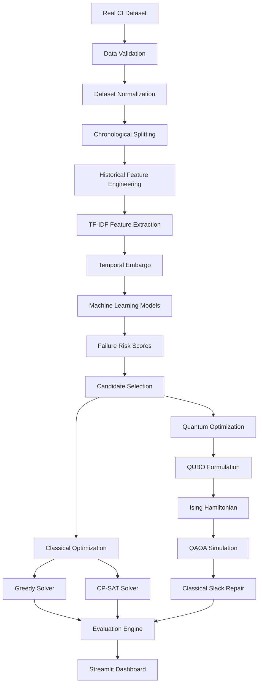
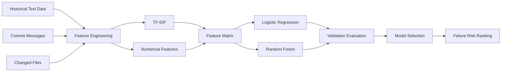
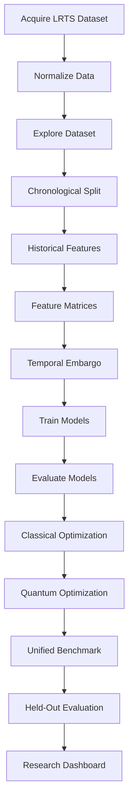

# QuantCI

### Machine Learning and Quantum-Classical Optimization for Intelligent Software Testing


## Overview

QuantCI is a research-oriented software test selection platform that combines machine learning, classical optimization and quantum-classical algorithms to investigate intelligent test prioritization under constrained execution budgets.

The system analyzes historical test behavior, commit messages and source-code changes to estimate failure risk and optimize test selection.

QuantCI is evaluated using real-world continuous integration data from Apache ActiveMQ through the Long-Running Test Suites (LRTS) dataset.

Rather than assuming that complex algorithms outperform simpler alternatives, QuantCI evaluates machine learning and quantum optimization against classical baselines and transparently documents their limitations.

## Quick Start

The dashboard uses precomputed prediction and evaluation artifacts stored in the `results/` directory.

With these artifacts available, no raw dataset download, model training or quantum simulation is required to explore the research results.

### 1. Clone the Repository

```bash
git clone https://github.com/karthikkb0580-cmd/Quant-CI.git
cd Quant-CI
```

### 2. Create a Virtual Environment

```bash
python -m venv .venv
```

### 3. Activate the Virtual Environment

Windows PowerShell:

```powershell
.\.venv\Scripts\Activate.ps1
```

Linux or macOS:

```bash
source .venv/bin/activate
```

### 4. Install Dependencies

```bash
python -m pip install -r requirements.txt
```

### 5. Verify the Environment

```bash
python verify_env.py
```

### 6. Launch the Dashboard

```bash
python -m streamlit run src/demo/app.py
```

Open the local address displayed in the terminal.

```text
http://localhost:8501
```

Python 3.14.10 on Windows is the verified development environment. Compatibility with other Python versions and operating systems has not been independently validated.

The complete Quick Start requires the saved prediction CSVs, evaluation reports and visualization artifacts. Clean-clone verification is pending.

## Key Features

- Real-world continuous integration dataset processing
- Chronological dataset splitting
- Temporal embargo validation
- Historical feature engineering
- TF-IDF text representation
- Logistic Regression and Random Forest
- Failure-risk prediction and ranking
- Budget-constrained test selection
- Greedy optimization
- Google OR-Tools CP-SAT optimization
- QUBO formulation
- Ising Hamiltonian conversion
- Quantum Approximate Optimization Algorithm
- Constraint-based quantum candidate pruning
- Classical slack repair
- Random sampling control experiments
- Held-out optimization evaluation
- Interactive Streamlit dashboard
- Automated regression testing

## System Architecture



## Dataset

QuantCI uses the Long-Running Test Suites dataset containing real-world continuous integration execution records.

| Attribute | Value |
|---|---:|
| Dataset | LRTS |
| Software project | Apache ActiveMQ |
| Test executions | 159,402 |
| Passed executions | 159,045 |
| Failed executions | 357 |
| Unique test classes | 1,112 |
| Test-suite runs | 207 |
| Unique commits | 177 |
| Overall failure rate | 0.224% |
| Engineered ML features | 726 |

### Chronological Dataset Split

| Partition | Executions | Failures | Suite Runs |
|---|---:|---:|---:|
| Training | 107,426 | 305 | 144 |
| Validation after embargo | 19,738 | 37 | 26 |
| Testing | 27,786 | 15 | 32 |

Five validation runs containing 4,452 executions were excluded through a temporal embargo to reduce cross-partition temporal contamination.

### Dataset Sources

- LRTS Repository: https://github.com/lrtsuser/LRTS
- Original Jenkins Reports: https://doi.org/10.5281/zenodo.15603448

The original raw dataset is not distributed with this repository.

## Machine Learning Pipeline



### Historical Features

- Historical execution count
- Historical failure count
- Historical failure rate
- Smoothed historical failure rate
- Previous failure outcome
- Historical execution duration
- Recent failure rates
- Consecutive failures
- Time since previous execution
- Time since previous failure
- Estimated test execution duration

### Text Features

- Commit message TF-IDF
- Changed file TF-IDF
- Test class name TF-IDF
- Test-to-commit similarity
- Test-to-file similarity

### Evaluated Models

| Model | Category |
|---|---|
| Majority baseline | Statistical baseline |
| Random ranking | Random baseline |
| Global failure rate | Statistical baseline |
| Historical failure rate | Historical baseline |
| Smoothed historical failure rate | Historical baseline |
| Logistic Regression | Machine learning |
| Random Forest | Machine learning |

Random Forest was selected using validation average precision. Model parameters were frozen for chronological test evaluation.

## Machine Learning Results

The test partition contains 27,786 test executions and only 15 observed failures.

| Metric | Random Forest | Smoothed Historical Baseline |
|---|---:|---:|
| Validation average precision | 0.06940 | 0.03770 |
| Test average precision | 0.02595 | 0.02867 |
| Test ROC AUC | 0.97310 | 0.98410 |
| Top 10% failure recall | 100% | 93.33% |
| Failures detected in top 10% | 15/15 | 14/15 |

### Random Forest Classification Metrics

| Metric | Value |
|---|---:|
| Accuracy | 99.68% |
| Precision | 4.88% |
| Recall | 26.67% |
| F1 Score | 0.08247 |
| ROC AUC | 0.97310 |
| Average precision | 0.02595 |
| Top 10% ranking recall | 100% |

### Confusion Matrix

| | Predicted Pass | Predicted Fail |
|---|---:|---:|
| Actual Pass | 27,693 | 78 |
| Actual Fail | 11 | 4 |

### Interpretation

The selected machine learning model is competitive with simple historical baselines, but it does not consistently outperform them.

Random Forest detected all 15 observed failures within the top 10% ranked test executions. However, the smoothed historical baseline achieved higher test average precision and ROC AUC.

Possible explanations include:

- Extreme class imbalance
- Limited positive training examples
- Only 15 observed failures in the test partition
- Strong predictive information in historical failure behavior
- Temporal changes in software test behavior
- Limited additional information from textual features

These explanations are plausible interpretations rather than independently established causal findings.

High classification accuracy is not sufficient evidence of strong failure detection because the dataset is extremely imbalanced.

The model outputs are uncalibrated risk scores rather than calibrated failure probabilities.

The results do not establish reliable generalization to other software repositories.

## Optimization Formulation

QuantCI maximizes predicted failure risk while penalizing test redundancy under an estimated execution budget.

### Objective Function

$$
\max_x \left(
\sum_i r_i x_i -
\lambda \sum_{i<j}s_{ij}x_ix_j
\right)
$$

### Budget Constraint

$$
\sum_i t_i x_i \leq B
$$

### Binary Selection Constraint

$$
x_i \in \{0,1\}
$$

| Symbol | Description |
|---|---|
| x | Binary test selection |
| r | Predicted failure risk |
| t | Estimated test execution duration |
| s | Test-name similarity |
| B | Estimated execution budget |
| lambda | Redundancy penalty |

Test-name similarity is used as a redundancy proxy rather than a direct measurement of code coverage.

## Classical Optimization

QuantCI implements six classical test selection strategies.

| Algorithm | Description |
|---|---|
| Random | Random candidate selection under budget |
| Shortest First | Prioritizes shorter estimated test durations |
| Historical Risk | Prioritizes historical failure behavior |
| ML Risk | Prioritizes machine learning risk scores |
| Greedy | Maximizes marginal objective gain per estimated duration |
| CP-SAT | Constraint programming-based optimization |

### Validation Benchmark

| Metric | Result |
|---|---:|
| Validation suite runs | 26 |
| Evaluated budgets | 4 |
| Optimization problems | 104 |
| Feasible Greedy solutions | 104/104 |
| Feasible CP-SAT solutions | 104/104 |
| CP-SAT optimal scaled solutions | 81 |
| CP-SAT feasible solutions | 23 |

CP-SAT optimality refers to the discretized and scaled mathematical formulation used by the solver.

## Held-Out Optimization Evaluation

The held-out evaluation investigates the trade-off between failure detection, execution cost reduction and actual budget feasibility.

| Attribute | Value |
|---|---:|
| Test-suite runs | 32 |
| Test executions | 27,786 |
| Observed failures | 15 |
| Runs containing failures | 11 |
| Selection strategies | 6 |
| Estimated execution budgets | 4 |
| Run-level evaluations | 768 |
| Maximum candidates per run | 200 |

All strategies use a shared ML-ranked candidate shortlist of up to 200 tests per run.

### Results at a 120-Second Estimated Budget

| Strategy | Failure Recall | Runtime Reduction | Budget Overrun | Missed Failure Runs |
|---|---:|---:|---:|---:|
| Random | 46.67% | 99.23% | 62.50% | 63.64% |
| Shortest First | 66.67% | 99.21% | 78.13% | 45.45% |
| Historical Risk | 60.00% | 99.26% | 59.38% | 54.55% |
| ML Risk | 66.67% | 99.19% | 65.63% | 45.45% |
| Greedy | 66.67% | 99.22% | 68.75% | 45.45% |
| CP-SAT | 66.67% | 99.22% | 75.00% | 45.45% |

### Failure Recall Across Execution Budgets

| Strategy | 60 Seconds | 120 Seconds | 300 Seconds | 600 Seconds |
|---|---:|---:|---:|---:|
| Random | 26.67% | 46.67% | 53.33% | 53.33% |
| Shortest First | 66.67% | 66.67% | 66.67% | 66.67% |
| Historical Risk | 66.67% | 60.00% | 66.67% | 60.00% |
| ML Risk | 60.00% | 66.67% | 80.00% | 66.67% |
| Greedy | 66.67% | 66.67% | 66.67% | 66.67% |
| CP-SAT | 66.67% | 66.67% | 66.67% | 66.67% |

### Highest Observed Failure Recall

The ML Risk strategy at a 300-second estimated execution budget achieved the highest observed failure recall across the evaluated configurations.

| Metric | Result |
|---|---:|
| Estimated execution budget | 300 seconds |
| Detected failures | 12/15 |
| Failure recall | 80.00% |
| Cumulative runtime reduction | 98.24% |
| Actual budget overrun rate | 56.25% |
| Detected failure runs | 8/11 |
| Failure-run detection rate | 72.73% |
| Missed failure-run rate | 27.27% |
| Candidate recall | 100% |
| Mean selection time | 1.784 ms |

This configuration was identified retrospectively and should not be interpreted as an independently validated deployment recommendation.

### Metric Definitions

**Failure Recall:** Proportion of observed failing test executions selected.

**Runtime Reduction:** Reduction in cumulative observed serial test duration compared with executing the complete test suite.

**Budget Overrun Rate:** Proportion of evaluated runs whose observed selected-test duration exceeds the estimated execution budget.

**Missed Failure-Run Rate:** Proportion of runs containing failures in which no failing test was selected.

**Candidate Recall:** Proportion of observed failures retained in the candidate shortlist.

### Interpretation

Large runtime reductions are accompanied by substantial failure misses and frequent actual budget overruns.

The optimization constraints use historical duration estimates, which do not guarantee that future execution durations remain within the specified budget.

The measured runtime reduction represents cumulative serial test duration rather than end-to-end CI pipeline wall-clock acceleration.

The evaluated selection strategies do not establish a consistently superior optimization approach for failure detection.

These findings indicate that duration uncertainty and failure detection reliability must be improved before practical deployment.

## Quantum Optimization

QuantCI formulates a small test selection instance as a Quadratic Unconstrained Binary Optimization problem.

The quantum component uses Qiskit Aer for local simulation.


### Quantum Pipeline Components

- Binary test selection variables
- Discretized execution duration
- Binary slack variables
- Constraint penalty formulation
- QUBO matrix construction
- Ising Hamiltonian conversion
- QAOA circuit optimization
- Measurement sampling
- Classical slack repair
- Exact solution verification

### Candidate Pruning

| Metric | Original | Pruned |
|---|---:|---:|
| Binary variables | 15 | 14 |
| State space | 32,768 | 16,384 |
| Candidate tests | 10 | 9 |
| Slack variables | 5 | 5 |

Constraint-based pruning reduced the encoded quantum state space by 50%.

The removed candidate was infeasible under the discretized execution budget.

Pruning preserved the exact optimal objective value for the evaluated instance.

### Quantum Experiment Configuration

| Parameter | Value |
|---|---|
| Quantum framework | Qiskit |
| Simulator | Qiskit Aer |
| Execution environment | Local CPU |
| QAOA repetitions | 1 and 2 |
| Measurement shots | 1,024 and 4,096 |
| Optimizer | COBYLA |
| Maximum iterations | 50 and 100 |
| Random seeds | 42, 123, 2026 |
| Estimated execution budget | 120 seconds |

## Quantum-Classical Benchmark

The unified benchmark evaluates seven optimization variants across 84 benchmark records on one shared validation instance.

| Algorithm | Mean Approximation Ratio | Mean Runtime |
|---|---:|---:|
| Greedy | 100.00% | 0.523 ms |
| CP-SAT | 100.00% | 7.982 ms |
| Exact Enumeration | 100.00% | 0.282 ms |
| Random Sampling | 89.56% | 404.618 ms |
| Random Sampling + Repair | 100.00% | 914.329 ms |
| QAOA | 93.90% | 3,353.287 ms |
| QAOA + Repair | 100.00% | 3,963.318 ms |

### Quantum Research Conclusion

At the evaluated problem size, QAOA with classical slack repair provides no demonstrated solution-quality advantage over random sampling with the same repair procedure.

Both repaired approaches achieved a mean approximation ratio of 100%.

However, QAOA with repair required approximately 4.33 times the runtime of random sampling with repair.

Classical exact enumeration was the fastest evaluated approach.

The experiment demonstrates a working QUBO-to-Ising-to-QAOA pipeline, but it does not establish quantum computational advantage.

The results suggest that classical repair plays an important role in the observed hybrid optimization performance.

Further experiments across larger and more diverse problem instances are required to investigate whether QAOA offers any meaningful benefit.

## Interactive Dashboard

QuantCI provides six interactive research sections.

| Section | Function |
|---|---|
| Overview | Project architecture and research summary |
| Dataset Intelligence | Dataset exploration and visualization |
| ML Intelligence | Model comparison and evaluation |
| Test Optimizer | Interactive Greedy and CP-SAT selection |
| Quantum Laboratory | Quantum-classical benchmark analysis |
| Research Analytics | Held-out evaluation and trade-off analysis |

### Dashboard Features

- Black-and-amber interface
- Animated visual elements
- Interactive research charts
- Dataset filtering
- Machine learning performance visualization
- Execution budget configuration
- Redundancy penalty configuration
- Interactive classical optimization
- Quantum benchmark comparison
- CSV export
- Research limitation reporting

## Technology Stack

| Layer | Technology |
|---|---|
| Programming Language | Python |
| Data Processing | NumPy, Pandas |
| Machine Learning | Scikit-learn |
| Sparse Computation | SciPy |
| Model Serialization | Joblib |
| Classical Optimization | Google OR-Tools |
| Quantum Computing | Qiskit |
| Quantum Simulation | Qiskit Aer |
| Quantum Algorithms | Qiskit Algorithms |
| Visualization | Matplotlib, Plotly |
| Frontend | Streamlit |
| Automated Testing | Pytest |
| Version Control | Git and GitHub |

## Project Structure

```text
QuantCI/
├── .github/
│   └── workflows/
├── .streamlit/
│   └── config.toml
├── data/
│   ├── raw/
│   └── processed/
├── docs/
│   ├── ARCHITECTURE.md
│   ├── DATASET.md
│   ├── METHODOLOGY.md
│   ├── EXPERIMENTS.md
│   ├── LIMITATIONS.md
│   ├── REPRODUCIBILITY.md
│   ├── USER_GUIDE.md
│   └── SECURITY.md
├── models/
├── results/
│   ├── benchmark/
│   ├── heldout/
│   ├── optimization/
│   ├── quantum/
│   ├── quantum_experiments/
│   ├── plots/
│   ├── final_evaluation_report.json
│   ├── final_test_predictions.csv
│   ├── final_validation_predictions.csv
│   └── test_report.xml
├── src/
│   ├── data/
│   ├── features/
│   ├── ml/
│   ├── optimization/
│   ├── quantum/
│   ├── evaluation/
│   ├── demo/
│   │   ├── components/
│   │   ├── assets/
│   │   ├── styles/
│   │   ├── views/
│   │   └── app.py
│   └── config.py
├── tests/
├── .gitignore
├── verify_env.py
├── requirements.txt
└── README.md
```

## Automated Testing

QuantCI includes an automated regression test suite covering the major research pipeline components.

Run all tests:

```bash
python -m pytest tests -v
```

Run tests in compact mode:

```bash
python -m pytest tests -q
```

Generate a machine-readable test report:

```bash
python -m pytest tests --junitxml=results/test_report.xml
```

### Latest Verified Test Results

```text
238 passed in 10.25s
```

### Test Coverage Areas

- Dataset validation
- Chronological dataset splitting
- Historical feature engineering
- Feature matrix construction
- Machine learning evaluation
- Candidate validation
- Optimization objective calculation
- Budget constraint enforcement
- Greedy optimization
- CP-SAT optimization
- QUBO formulation
- Ising Hamiltonian conversion
- Candidate pruning
- Quantum solution verification
- Benchmark evaluation
- Held-out evaluation

## Environment Verification

```bash
python verify_env.py
```

The environment checker:

- Accepts Python 3.14 or newer
- Verifies installed dependencies
- Checks virtual environment status
- Prepares required local directories
- Reports missing dependencies

The minimum version check does not guarantee dependency compatibility with future Python releases.

## Reproducing the Research Pipeline

The Quick Start uses saved research artifacts.

Full experimental reproduction requires separately acquiring the original dataset and executing the complete research pipeline.



See [Reproducibility Documentation](docs/REPRODUCIBILITY.md) for the research workflow.

## Research Contributions

- Developed a real-world CI test selection pipeline using 159,402 test executions.
- Constructed 726 numerical and textual machine learning features.
- Implemented chronological evaluation with a temporal embargo.
- Compared machine learning models against simple historical baselines.
- Implemented budget-constrained classical optimization.
- Constructed and verified QUBO and Ising Hamiltonian formulations.
- Reduced the encoded quantum state space by 50% through constraint-based candidate pruning.
- Compared QAOA against random sampling with equivalent classical repair.
- Evaluated six selection strategies across 768 held-out run-level experiments.
- Reported runtime reduction alongside failure misses and actual budget overruns.
- Developed an interactive research dashboard.
- Verified the implementation through 238 automated regression tests.

## Research Limitations

- Evaluation is restricted to one software repository.
- The dataset is extremely imbalanced.
- Only 15 failing executions are present in the test partition.
- Historical baselines remain competitive with machine learning.
- Model scores are not calibrated probabilities.
- The temporal embargo reduces a known contamination risk but does not establish complete absence of temporal leakage.
- Jenkins timestamp semantics have not been fully independently verified.
- Candidate test rosters are retrospectively observed.
- Held-out selection strategies share an ML-generated candidate shortlist.
- Random held-out selection uses one repetition per run and budget.
- Estimated test durations frequently underestimate observed execution costs.
- Runtime reduction does not represent measured parallel CI acceleration.
- Failing test executions do not necessarily correspond to unique software defects.
- Test-name similarity does not directly measure code coverage.
- Quantum experiments are restricted to one small validation instance.
- Quantum simulator performance does not establish hardware performance.
- Quantum computational advantage was not demonstrated.

## Future Work

- Evaluation across multiple software repositories
- Live CI/CD pipeline integration
- Probability calibration
- Runtime uncertainty estimation
- Robust budget-constrained optimization
- Independent full-suite baseline comparisons
- Repeated random-control experiments
- Code coverage-based redundancy estimation
- Parallel test execution scheduling
- Multi-objective optimization
- Larger quantum optimization experiments
- Quantum hardware evaluation
- Cloud-hosted research dashboard

## Development Environment

| Component | Specification |
|---|---|
| Operating System | Windows |
| Processor | Intel Core i5 |
| Memory | 16 GB RAM |
| GPU | NVIDIA RTX 3050 |
| Python | 3.14.10 |
| Quantum Execution | CPU-based local simulation |
| Development Cost | Free and open-source tools |

## Project Status

| Component | Status |
|---|---|
| Dataset Processing | Completed |
| Feature Engineering | Completed |
| Machine Learning | Completed |
| Classical Optimization | Completed |
| QUBO Formulation | Completed |
| Ising Hamiltonian | Completed |
| QAOA Simulation | Completed |
| Hybrid Quantum Optimization | Completed |
| Unified Benchmarking | Completed |
| Held-Out Evaluation | Completed |
| Streamlit Dashboard | Implemented |
| Automated Testing | 238 Tests Passed |
| GitHub Actions | Planned |
| Clean-Clone Verification | Pending |
| Cloud Deployment | Planned |

## Author

**Karthik K B**

B.Tech Artificial Intelligence and Machine Learning

GitHub: https://github.com/karthikkb0580-cmd

## Acknowledgements

- Long-Running Test Suites dataset contributors
- Apache ActiveMQ community
- NumPy and Pandas contributors
- Scikit-learn contributors
- Google OR-Tools contributors
- Qiskit open-source community
- Streamlit contributors
- Pytest contributors

## Disclaimer

QuantCI is an academic research prototype designed to investigate machine learning and quantum-classical optimization for software test selection.

It is not intended to replace comprehensive software testing or production-grade continuous integration quality assurance.

The reported results are specific to the evaluated dataset, experimental configurations and local execution environment.

No claim of quantum computational advantage or production readiness is made.