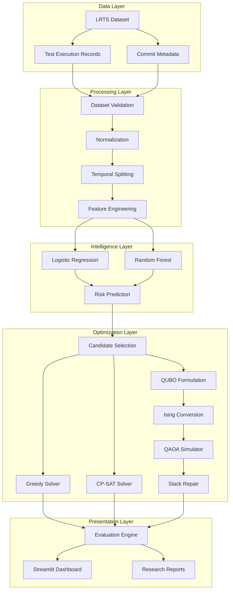

# QuantCI System Architecture

## Architecture Overview

QuantCI follows a modular, local-first research architecture.

## Design Principles

- Modular implementation
- Local-first execution
- Reproducible experimentation
- Temporal data separation
- Conservative execution constraints
- Independent solution verification
- Transparent research limitations

## Data Storage

Raw data, processed datasets, trained models and experiment artifacts are stored locally.

No external database or paid cloud service is required.

## Deployment

The application runs locally through Streamlit.

The research pipeline and dashboard operate within the same Python environment.